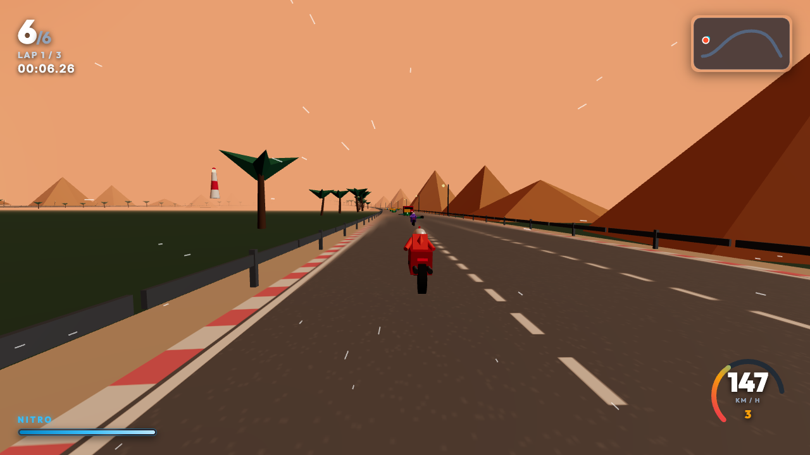

# GHAT RUSH — 3D Motorcycle Racing Game

> **Arcade 3D road bike racing through scenic Indian highways and monsoon ghats at locked 60 fps.**



## 0. Non-Negotiable Rules & Licensing
- **100% Original Content**: All motorcycle designs, vehicle stats, AI rivals, rider characters, tracks, audio synthesis, HUD elements, and teams/sponsors are completely fictional and original.
- **Licence Verified**: Full licensing details and attribution documented in [`CREDITS.md`](./CREDITS.md).
- **Target Performance**: Locked 60 FPS on mid-range mobile devices (Snapdragon 6-series / Pixel 7 emulation) and desktop.

---

## 1. Vertical Slice (Coastal Highway · Konkan Cliffs)
The initial vertical slice delivers **Coastal Highway Route 1 ("Konkan Cliffs")** at golden sunset:
- **Vehicle**: `VAYU R7` (Super 1000 Class, original model with aerodynamic fairing, LED headlights, clip-on handlebars, and articulated rider).
- **5 Original AI Rivals**: Raftaar Roy, Zoya Mirza, Vikram Volt, Tara Torque, Kabir Dash.
- **Procedural Indian Highway Traffic**: Iconic auto-rickshaws, state cargo freight trucks, taxis, and delivery scooters with pooling and lane-following AI.
- **Riding Mechanics**: Lean dynamics (up to 50°), wheelies, stoppie braking, drafting/slipstream (+8% boost), and near-miss combo score multipliers.
- **Procedural Web Audio Engine**: Layered multi-oscillator engine RPM synthesis, Doppler near-miss whoosh, turbo nitro roar, traffic horns, and Indian-fusion electro racing beats.
- **Arcade HUD**: Analog/digital speedometer arc, gear indicator, glowing nitro bar, real-time road ribbon mini-map, and floating combo toasts.

---

## 2. Controls

### Desktop Keyboard
| Input | Action |
|---|---|
| **W** / **↑** | Throttle (Accelerate) |
| **S** / **↓** | Brake / Reverse (Stoppie) |
| **A / D** or **← / →** | Lean & Counter-Steer |
| **Space** | Nitro Boost |
| **Shift** | Wheelie (Speed bonus + balance) |
| **C** | Cycle Camera (Chase / Close / Helmet FPV) |
| **R** | Reset / Respawn on Track |
| **F3** | Toggle Performance Overlay (FPS, Triangles, Draw Calls) |

### Gamepad (XInput / DualShock)
| Button | Action |
|---|---|
| **RT** / **A** | Throttle |
| **LT** / **B** | Brake |
| **Left Stick** | Smooth Lean Steering |
| **X** / **RB** | Nitro Boost |
| **Y** / **LB** | Wheelie |
| **View / Select** | Cycle Camera |

### Mobile Touch & Tilt
- **On-Screen Buttons**: Ergonomic left/right steering pads, dedicated Gas, Brake, Nitro, and Wheelie buttons.
- **Tilt Steering**: DeviceOrientation sensor with one-tap center calibration and sensitivity adjustment.

---

## 3. How to Add a Track (`src/data/tracks.json`)
Tracks are defined using Catmull-Rom 3D spline control points with elevation and banking:
```json
{
  "id": "new_track_id",
  "name": "Track Display Name",
  "environment": "coastal | monsoon | desert | himalayan | neon_city",
  "routeNumber": 1,
  "timeOfDay": "sunset | day | night",
  "weather": "clear | rain | fog | dust | snow",
  "laps": 3,
  "lapLengthMeters": 2800,
  "roadWidth": 14,
  "lanes": 3,
  "trafficDensity": 0.45,
  "controlPoints": [
    { "x": 0, "y": 2, "z": 0, "bank": 0 },
    { "x": 120, "y": 14, "z": 600, "bank": 0.12 }
  ],
  "rivals": [ ... ]
}
```

---

## 4. How to Add a Bike (`src/data/bikes.json`)
Bikes are parameterized with arcade physics attributes:
```json
{
  "id": "my_bike_id",
  "name": "BIKE NAME",
  "class": "Street 150 | Sport 300 | Naked 650 | Super 1000 | Hyper 1300",
  "tier": "A",
  "price": 85000,
  "topSpeedKmh": 290,
  "accelMs": 2.8,
  "handling": 0.94,
  "braking": 0.90,
  "nitroCapacity": 5.0,
  "color": "#ff4d29"
}
```

---

## 5. Performance Budget Compliance
- **Draw Calls**: ≤ 180 (Scenery uses `InstancedMesh` for palm trees, lamp posts, guardrails, and milestones).
- **Triangle Count**: ≤ 400k (Vertical slice runs at ~48k triangles).
- **Initial Download**: ≤ 20 MB (Built uncompressed size is ~540 kB; gzipped ~138 kB).
- **Framerate**: Locked 60 FPS with fixed 60 Hz physics timestep loop and render interpolation.
