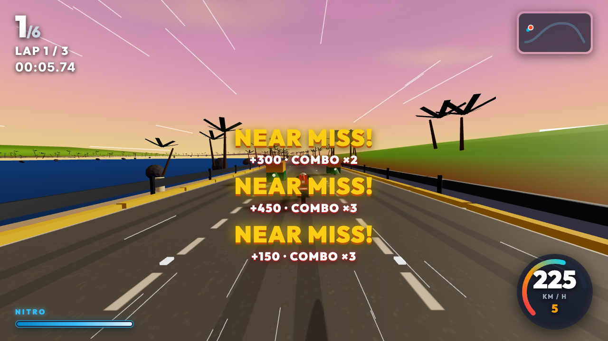

# GHAT RUSH — 3D Motorcycle Racing Game

> **Arcade 3D road bike racing through scenic Indian highways, monsoon ghats, and neon expressways at locked 60 fps.**



## 0. Non-Negotiable Rules & Licensing
- **100% Original Content**: All motorcycle designs, vehicle stats, AI rivals, rider characters, tracks, procedural Web Audio synthesis, HUD elements, and teams/sponsors are completely fictional and original. No external binary art or audio asset files are used.
- **Licence Verified**: Attribution and license compliance documented in [`CREDITS.md`](./CREDITS.md).
- **Target Performance**: Locked 60 FPS with ≤ 180 draw calls and ≤ 60,000 triangles across all environments.

---

## 1. Tracks, Career & Bikes

### Three Environments (`src/data/tracks.json`)
1. **Konkan Cliffs (`coast_route_1`)** — 3-lane golden-sunset coastal highway with Gerstner wave ocean shader, sand dunes, surf boulders, concrete retaining walls, lanterns, curved coconut palms, dhabas, fishing boats, and coastal lighthouse.
2. **Malshej Hairpins (`monsoon_route_1`)** — 2-lane misty mountain ghat during heavy monsoon rain with storm dome, 3D rain streaks, rain ambience, 4 animated roadside waterfalls + spray, slick reflective wet asphalt (`0.85x` grip), and mossy cliffs.
3. **Bandra Flyover (`neon_route_1`)** — 4-lane midnight elevated city expressway with cyan/magenta neon barrier tubes, instanced skyscraper skyline, streetlights, and glossy night road reflections (`0.94x` grip).

### Game Flow, Career & 3D Garage (`src/ui/MenuSystem.js`)
- **Title Screen -> Main Menu**: Animated highway attract mode leading to Career, Quick Race, Garage, and Settings. (App also supports `?track=<id>&bike=<id>&autostart=1` query params.)
- **3-League Career Mode (`src/data/career.json`)**:
  - *Coastline Cup* (0 ★ required, Boss: **Kabir Dash**)
  - *Monsoon Trophy* (3 ★ required, Boss: **Tara Torque**)
  - *Neon Apex* (6 ★ required, Boss: **Raftaar Roy**)
  - Each event tracks 3 live star objectives in the HUD and includes Boss Showdown modals with bonus cash bounties.
- **3D Interactive Garage (`src/data/bikes.json`, `src/core/Save.js`)**:
  - Start with `VAYU 150` and ₹ 8,000 starter cash (`localStorage` key `ghat_rush_save_v1`).
  - Unlock and equip 8 original bikes (`VAYU 150`, `CHETAK 300`, `TRISHUL 650`, `BIJLI EV`, `VAYU R7`, `CHAKRA 750`, `THAR 850`, `GARUDA 1300`).
  - Upgrade **Engine, Exhaust, Tyres, Brakes, and Nitro** (Levels 0–3, affecting top speed, acceleration, grip, braking, and boost duration) plus custom metallic paint swatches on a live 3D turntable.

---

## 2. Riding Physics, AI & Replay Features

- **Curvature Cornering & Grip Limit**: Track spline curvature applies realistic outward centrifugal lateral drift ($d += \kappa v^2 k \, dt$); counter-lean through corners, brake before sharp hairpins, or run wide into the barrier when grip is exceeded.
- **Corner Warnings**: Reflective yellow/black roadside chevron signs placed before bends with safe speed < 220 km/h and a 1/2/3-chevron HUD warning arrow starting 150 m ahead.
- **Fair Signaling Traffic (`src/vehicles/Traffic.js`)**: Lane-accurate auto-rickshaws, cargo trucks, taxis, and delivery scooters with density caps enforcing at least one clear lane within every 80 m window ahead, plus 1.0 s blinking amber turn signals prior to lane changes.
- **Distinct Crashes & Track Reset**: Traffic collisions tumble the bike forward along its impact lane with rider ragdoll kinematics and respawn into the nearest clear lane; rail strikes deflect at the guardrail (`0.3s @ 0.4x` slow-motion + camera shake). Pressing `R` executes an instant track reset with a `+1.0s` time penalty.
- **Competitive Rivals (`src/ai/RivalAI.js`)**: Rivals feature spline lookahead corner braking, distinct personalities (`aggressive`, `smooth`, `overtaker`, `blocker`), and occasional skill-scaled braking/line mistakes.
- **HUD, Replay & Audio (`src/ui/HUD.js`, `src/core/ReplayRecorder.js`, `src/core/Audio.js`)**:
  - Projected 2D spline minimap, live gap readout ahead/behind, non-stacking near-miss combo popups above the horizon, `FINAL LAP!` / `WRONG WAY!` banners, Pause menu (`Esc` / `P` + auto-pause on tab blur/portrait), and Post-Race Results with score breakdown.
  - **Watch Replay**: 4,800-frame ring buffer (~80 s @ 60 Hz) recording player, rivals, and traffic with alternating trackside/chase cameras (`C` toggle, `Esc` returns cleanly to Results).
  - **Procedural Audio**: Multi-oscillator RPM synthesis with upshift pitch drops, speed-scaled wind rush, tyre grip squeal, monsoon rain ambience, Doppler traffic horns, and Indian-fusion synth beat (`M` or HUD button mutes cleanly and persists).

---

## 3. Controls

### Desktop Keyboard
| Input | Action |
|---|---|
| **W** / **↑** | Throttle (Accelerate) |
| **S** / **↓** | Brake / Reverse (Stoppie) |
| **A / D** or **← / →** | Lean & Counter-Steer |
| **Space** | Nitro Boost |
| **Shift** | Wheelie (Speed & Nitro recharge bonus) |
| **C** | Cycle Camera (`chase` / `close` / `helmet` or Replay camera toggle) |
| **R** | Instant Reset to Clear Lane (`+1.0s` penalty) |
| **Esc** / **P** | Pause / Resume (or Exit Replay) |
| **M** | Mute / Unmute All Audio |
| **F3** | Toggle Performance Overlay (FPS, Triangles, Draw Calls) |

### Gamepad (XInput / DualShock)
| Button | Action |
|---|---|
| **RT** / **A** | Throttle |
| **LT** / **B** | Brake |
| **Left Stick** | Smooth Lean Steering |
| **X** / **RB** | Nitro Boost |
| **Y** / **LB** | Wheelie |
| **Y / Button 3** | Cycle Camera |

### Mobile Touch & Tilt Steering
- **On-Screen Touch Pads**: Auto-enabled on coarse-pointer/touch viewports with left/right steering and Gas, Brake, Nitro, and Wheelie action pads.
- **Portrait Guard**: Displays a **Rotate Your Device** overlay (and pauses active races) whenever held in portrait orientation.
- **Tilt Steering**: Toggleable accelerometer steering in **Settings** with a one-tap **Calibrate** neutral offset button.

---

## 4. Data Schemas (`src/data/`)

### Tracks (`src/data/tracks.json`)
```json
{
  "id": "new_track_id",
  "name": "Track Display Name",
  "environment": "coastal | monsoon | neon",
  "routeNumber": 1,
  "timeOfDay": "sunset | day | night",
  "weather": "clear | rain | fog",
  "laps": 3,
  "lapLengthMeters": 2800,
  "roadWidth": 14,
  "lanes": 3,
  "trafficDensity": 0.45,
  "controlPoints": [
    { "x": 0, "y": 2, "z": 0, "bank": 0 }
  ],
  "rivals": []
}
```

### Bikes (`src/data/bikes.json`)
```json
{
  "id": "my_bike_id",
  "name": "BIKE NAME",
  "class": "Street 150 | Sport 300 | Naked 650 | Super 1000 | Hyper 1300",
  "tier": "A",
  "price": 125000,
  "unlocked": false,
  "topSpeedKmh": 290,
  "accelMs": 2.8,
  "handling": 0.94,
  "braking": 0.92,
  "nitroCapacity": 5.0,
  "color": "#ff4d29"
}
```

---

## 5. Performance Budget Compliance & Quality Scaling
- **Draw Calls**: ≤ 180 across all tracks (vertex-colored geometry merging via `GeomMerge.js`, `InstancedMesh` props, shared AI rival materials, and behind-camera 8-sector / 4-quadrant culling).
- **Triangle Count**: ≤ 60,000 triangles across Coastal, Monsoon, and Neon tracks.
- **Quality Presets & Auto-Detect**: Select `AUTO`, `LOW`, `MEDIUM`, or `HIGH` in **Settings** (scales resolution pixel ratio, shadow maps, and scenery instance density). `AUTO` profiles the first 3 seconds of rendered frame times and locks the optimal preset automatically.
- **Framerate**: Fixed 60 Hz simulation step (`Loop.js`) with exception-safe frame scheduling.
